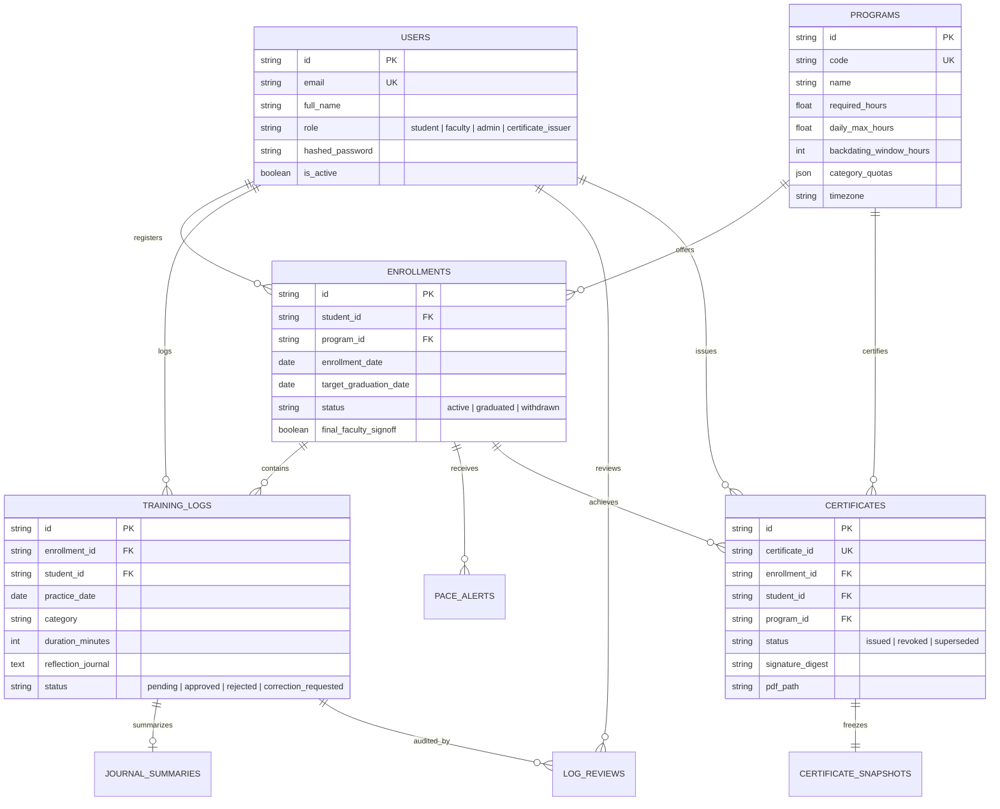

# Shailja Yoga — 200-Hour Yoga Teacher Training Certification (TTC) Platform

[](https://www.python.org/)
[](https://fastapi.tiangolo.com/)
[](https://react.dev/)
[](https://www.typescriptlang.org/)
[](https://tailwindcss.com/)
[](https://docs.pytest.org/)
[]()

An enterprise-grade, authoritative web platform for Shailja Yoga's certified **200-Hour Yoga Teacher Training Certification (TTC)** program.

The platform provides a complete, tamper-evident system for student practice hours logging, faculty verification queues, linear schedule pace monitoring, automated natural language reflection briefs, dynamic PDF certificate generation with embedded cryptographic digests, and an anti-scraping public alumni verification registry.

---

## Table of Contents

1. [Executive Overview & Problem Statement](#1-executive-overview--problem-statement)
2. [Authoritative Business Invariants](#2-authoritative-business-invariants)
3. [System Architecture](#3-system-architecture)
4. [Data Model & Entities](#4-data-model--entities)
5. [Key Platform Capabilities](#5-key-platform-capabilities)
6. [API Specification & Standard Envelopes](#6-api-specification--standard-envelopes)
7. [Security, Cryptography & Privacy](#7-security-cryptography--privacy)
8. [Local Setup & Installation](#8-local-setup--installation)
9. [Pre-Configured Accounts Directory](#9-pre-configured-accounts-directory)
10. [Automated Verification Test Matrix](#10-automated-verification-test-matrix)

---

## 1. Executive Overview & Problem Statement

Yoga Teacher Training Certification (TTC) standards mandate rigorous curriculum tracking across multiple physical and academic disciplines. Traditional logbooks, spreadsheets, and manual sign-offs suffer from backdating vulnerabilities, unverified hours, inconsistent category distributions, and counterfeit credentials.

The **Shailja Yoga TTC Platform** eliminates these vulnerabilities by acting as the single authoritative source of truth. Every submitted training session is bound by strict calendar boundaries, faculty review workflows, linear pace projections, and immutable audit logs. Upon curriculum completion, the platform generates high-resolution, tamper-evident certificates protected by HMAC-SHA256 digital signatures and scannable QR verification codes.

---

## 2. Authoritative Business Invariants

The platform enforces seven non-negotiable rules directly within the core backend domain engine:

1. **200 Faculty-Approved Hours Threshold:** Certification strictly requires at least 200 faculty-approved hours. Pending, unreviewed, or rejected hours **never** count toward certification or progress.
2. **8-Hour Combined Daily Limit:** A student may log a maximum of **8.0 hours (480 minutes)** per program calendar day across all four curriculum categories combined. Multi-submission bypass attempts are rejected atomically.
3. **48-Hour Backdating Boundary:** Practice logs submitted more than 48 hours after the practice date are rejected to ensure timely documentation.
4. **Four Canonical Curriculum Categories:**
   - `asana_practice` (Asana Practice & Physical Training)
   - `anatomy` (Anatomy & Musculoskeletal Physiology)
   - `yoga_philosophy` (Yoga Philosophy, Ethics & Yogic Lifestyle)
   - `practical_teaching` (Practical Teaching Methodology & Adjustments)
5. **Server-Authoritative Validation:** All hours, daily capacity limits, category quota satisfactions, and certificate eligibility are computed exclusively on the server. Client-side state is treated as untrusted.
6. **Automated Reflection Digests as Decision Support:** Natural language reflection summaries assist faculty mentors during review but **never** approve hours or determine graduation eligibility.
7. **Strict Public Data Minimization:** The public verification registry confirms graduate credentials without leaking private reflection journals, phone numbers, email addresses, faculty notes, or server filesystem paths.

---

## 3. System Architecture

```
┌────────────────────────────────────────────────────────────────────────┐
│                   React 18 + TypeScript + Vite SPA                     │
│    (Responsive Tailwind UI · Dynamic Dashboard · Public Registry)      │
└───────────────────────────────────┬────────────────────────────────────┘
                                    │ REST API / JSON Envelopes
                                    ▼
┌────────────────────────────────────────────────────────────────────────┐
│                        FastAPI Application Core                        │
│                                                                        │
│  ┌───────────────────────┐  ┌──────────────────────────────────────┐  │
│  │ JWT RBAC & Middleware │  │ Anti-Scraping Sliding Rate Limiter   │  │
│  └───────────┬───────────┘  └──────────────────┬───────────────────┘  │
│              ▼                                 ▼                      │
│  ┌─────────────────────────────────────────────────────────────────┐  │
│  │                    Core Domain Service Layer                    │  │
│  │  • Validation Service (8h Daily Cap, 48h Backdating Check)      │  │
│  │  • Progress Service (Authoritative Verified Hours Tracking)     │  │
│  │  • Pace Service (Linear Schedule Projection & Alerts)           │  │
│  │  • Summary Service (Natural Language Reflection Processing)     │  │
│  │  • Certificate Service (6 Invariant Checks & Lifecycle)         │  │
│  │  • PDF Generator (ReportLab High-Res Landscape + QR Code)       │  │
│  └───────────────────────────────┬─────────────────────────────────┘  │
└──────────────────────────────────┼────────────────────────────────────┘
                                   ▼
┌────────────────────────────────────────────────────────────────────────┐
│                Persistence Layer (SQLAlchemy 2.0 ORM)                  │
│       PostgreSQL (Production) / SQLite Fallback (Local Dev)            │
│                 Alembic Database Version Control                       │
└────────────────────────────────────────────────────────────────────────┘
```

---

## 4. Data Model & Entities



---

## 5. Key Platform Capabilities

### 5.1 Trainee Hours Logging
- **Calendar Boundary Checks:** Real-time validation preventing future-dated sessions and sessions outside the 48-hour boundary.
- **Combined Daily Capacity Preview:** Real-time API query showing existing minutes logged and remaining daily capacity.
- **Reflection Journaling:** Mandatory qualitative reflection capture for faculty mentoring.

### 5.2 Faculty Review Queue & Progress Verification
- **Filterable Queue:** Segregated views for `pending`, `approved`, `rejected`, and `correction_requested` logs.
- **Natural Language Practice Digests:** Automated extraction of *Key Learnings*, *Practice Reflections*, and *Topics for Review* grounded directly in the student's text, with SHA-256 staleness tracking when journals change.
- **Mandatory Feedback:** Form-enforced justification required whenever a log is rejected or flagged for correction.
- **Final Faculty Sign-Off:** Explicit graduation readiness authorization required before certification.

### 5.3 Schedule Pace Monitor & Alert Engine
- **Linear Expected Hours:** Calculates where a student should be based on elapsed days vs total program duration.
- **Shortfall Tracking:** Identifies trainees falling behind schedule ($\ge 10.0\text{h}$ shortfall).
- **Feasibility Bounds:** Evaluates whether remaining hours can be completed before the deadline without exceeding the strict 8h/day limit.
- **Deduplication:** Prevents duplicate alert dispatches for active shortfall conditions.

### 5.4 Dynamic Certificate Generation & Lifecycle
- **6-Criteria Server Verification:** Validates hours ($\ge 200$), category minimums, zero pending logs, faculty sign-off, active student status, and duplicate issuance protection.
- **Dynamic ReportLab PDF:** High-resolution landscape Letter layout with decorative navy/gold borders, curriculum breakdown, lead signatory details, and high-contrast QR code.
- **Cryptographic Digest:** HMAC-SHA256 signature calculated over immutable student, program, date, and hours snapshot attributes.
- **Lifecycle Management:** Complete audit support for certificate revocations (with mandatory reason) and superseding replacements.

### 5.5 Public Alumni Verification Portal
- **Global Unauthenticated Verification:** Public verification by certificate ID.
- **Anti-Scraping Protection:** Sliding-window in-memory rate limiting returning `HTTP 429` on excessive lookups.
- **Strict Data Minimization:** Public view displays verified status, curriculum hours, graduate name, and completion date, while strictly omitting private journals, phone numbers, and internal notes.

---

## 6. API Specification & Standard Envelopes

Every API endpoint adheres to a standardized JSON response envelope:

```json
{
  "success": true,
  "data": { ... },
  "message": "Human readable status message",
  "error": null
}
```

### Core Endpoints

| Method | Endpoint | Description | Access |
| :--- | :--- | :--- | :--- |
| `POST` | `/api/v1/auth/signup` | Register new student & auto-enroll in TTC 200 | Public |
| `POST` | `/api/v1/auth/login` | Authenticate & retrieve JWT Bearer token | Public |
| `GET` | `/api/v1/auth/me` | Fetch authenticated user profile | Authenticated |
| `POST` | `/api/v1/logs` | Submit daily practice session (8h cap & 48h check) | Trainee |
| `GET` | `/api/v1/logs/me` | Retrieve student's practice history | Trainee |
| `GET` | `/api/v1/logs/daily-capacity` | Query remaining daily hours allowance | Trainee |
| `GET` | `/api/v1/faculty/reviews` | Retrieve review queue with status/category filters | Faculty / Admin |
| `POST` | `/api/v1/faculty/logs/{id}/review` | Approve, reject, or request correction with feedback | Faculty |
| `POST` | `/api/v1/faculty/enrollments/{id}/signoff` | Grant final faculty graduation sign-off | Faculty |
| `GET` | `/api/v1/progress/me` | Authoritative verified progress & category breakdown | Trainee |
| `GET` | `/api/v1/alerts/me` | Linear pace calculation, shortfall & feasibility | Trainee |
| `POST` | `/api/v1/summaries/logs/{id}/summary` | Generate grounded natural language practice brief | Faculty |
| `GET` | `/api/v1/certificates/eligibility/{id}` | Run 6-criteria certificate eligibility check | Authenticated |
| `POST` | `/api/v1/certificates/issue` | Generate PDF certificate with QR code & digest | Issuer / Admin |
| `POST` | `/api/v1/certificates/{id}/revoke` | Revoke certificate with mandatory audit reason | Issuer / Admin |
| `GET` | `/api/v1/public/certificates/{id}` | Verify certificate credentials globally | Public (Rate-Limited) |
| `GET` | `/api/v1/public/certificates/{id}/download` | Download official certificate PDF | Public (Rate-Limited) |
| `GET` | `/api/v1/health` | Operational health and database connectivity | Public |

---

## 7. Security, Cryptography & Privacy

- **Password Storage:** Uses **Argon2id** (via `pwdlib`) with memory, time, and parallelism costs meeting OWASP security recommendations.
- **Authentication & RBAC:** Compact, cryptographically signed **JWT (HS256)** bearer tokens carrying verified user IDs and role claims (`student`, `faculty`, `admin`, `certificate_issuer`).
- **Certificate Verification:** Dynamic HMAC-SHA256 signature generated over normalized credential attributes (`student_id`, `program_id`, `completion_date`, `total_hours`, `issue_date`).
- **Data Minimization:** Explicit Pydantic schemas ensure private reflections, student contact details, and internal review comments never leave the internal network on public endpoints.
- **Tenant & Student Isolation:** SQL queries are parameterized and explicitly scoped to the authenticated student's `student_id` or `enrollment_id`.

---

## 8. Local Setup & Installation

### Prerequisites
- **Python:** 3.12 or higher (fully tested on Python 3.14)
- **Node.js:** 18.0 or higher
- **npm:** 9.0 or higher

### 8.1 Backend Setup

1. **Clone the repository:**
   ```bash
   git clone https://github.com/Ishaansharma01/Bizznnovate2026.git
   cd Bizznnovate2026
   ```

2. **Configure environment variables:**
   ```bash
   cp .env.example .env
   ```

3. **Install Python dependencies:**
   ```bash
   python -m pip install -r backend/requirements.txt
   ```

4. **Run database migrations:**
   ```bash
   python -m alembic -c backend/alembic.ini upgrade head
   ```

5. **Start the FastAPI backend server:**
   ```bash
   python -m uvicorn app.main:app --app-dir backend --reload --port 8000
   ```
   - Interactive OpenAPI documentation: `http://127.0.0.1:8000/docs`
   - Health check: `http://127.0.0.1:8000/api/v1/health`

### 8.2 Frontend Setup

1. **Navigate to the frontend directory:**
   ```bash
   cd frontend
   ```

2. **Install frontend dependencies:**
   ```bash
   npm install
   ```

3. **Start the Vite development server:**
   ```bash
   npm run dev
   ```
   - Application URL: `http://localhost:5173`
   - Public Verification Registry: `http://localhost:5173/verify`

4. **Build for production:**
   ```bash
   npm run build
   ```

---

## 9. Pre-Configured Accounts Directory

All pre-seeded local development accounts use the password: **`password123`**

| Role | Name | Email Address | Description & Test Workflow |
| :--- | :--- | :--- | :--- |
| **Student (Trainee)** | Ananya Sharma | `student1@shailjayoga.com` | Active student with logs in progress; test daily log submissions, capacity limits, and pace warnings. |
| **Student (Graduate)** | Dev Patel | `student2@shailjayoga.com` | Completed alumnus with 200/200 approved hours; test certificate download and QR verification. |
| **Faculty Reviewer** | Acharya Ramesh | `faculty@shailjayoga.com` | Access pending queue, trigger natural language practice briefs, approve/reject logs, grant final sign-off. |
| **Certificate Issuer** | Director Shailja | `issuer@shailjayoga.com` | Evaluate 6 graduation criteria, issue dynamic PDF certificates, revoke credentials. |
| **Master Admin** | Master Admin | `admin@shailjayoga.com` | Manage cohort programs, set canonical category quotas, configure backdating rules. |

*(New trainees can also register directly using the **Sign Up (New Student)** tab on the portal screen).*

---

## 10. Automated Verification Test Matrix

The platform includes a test suite with **69 automated integration tests** covering every functional module and invariant:

```bash
python -m pytest backend/tests -v
```

```
============================= test session starts =============================
backend/tests/test_auth.py (9 tests) ................................... PASSED
backend/tests/test_logs_engine.py (8 tests) ............................. PASSED
backend/tests/test_faculty_progress.py (6 tests) ........................ PASSED
backend/tests/test_pace_monitor.py (6 tests) ............................ PASSED
backend/tests/test_journal_summary.py (4 tests) ......................... PASSED
backend/tests/test_certificates.py (12 tests) ........................... PASSED
backend/tests/test_public_verification.py (9 tests) ..................... PASSED
backend/tests/test_end_to_end_acceptance.py (9 tests) ................... PASSED
backend/tests/test_programs_enrollments.py (2 tests) .................... PASSED
backend/tests/test_foundation.py (4 tests) .............................. PASSED
backend/tests/test_health.py (2 tests) .................................. PASSED
======================== 69 passed, 0 failed in 170.27s ========================
```

### Verified Acceptance Scenarios:
1. **Full Lifecycle Journey:** Student registration $\rightarrow$ logging hours $\rightarrow$ faculty review queue $\rightarrow$ practice digest generation $\rightarrow$ faculty approval $\rightarrow$ pace update $\rightarrow$ final sign-off $\rightarrow$ certificate issuance $\rightarrow$ public verification.
2. **Strict Invariant: 199 Approved Hours + 5 Pending Hours:** Confirms that certification is blocked with `UNMET_CRITERIA` because unapproved hours never count.
3. **Category Quota Minimums:** Confirms that 200 total hours with an unmet category quota blocks graduation.
4. **Multi-Submission Daily Cap Defense:** Confirms multiple logs on the same calendar day cannot exceed 8.0 hours combined.
5. **Idempotent Issuance:** Repeated issuance requests return the existing credential without creating duplicates.
6. **Revocation & PDF Block:** Confirms revoked credentials display warnings on the public registry and return `HTTP 409 Conflict` on download attempts.
7. **Resilient Service Fallback:** Confirms external network downtime in reflection processing gracefully falls back to deterministic extraction without blocking reviews.
8. **Strict Privacy Defense:** Confirms zero leakage of reflection journals, emails, phone numbers, or notes on public routes.

---

## License

This project is developed for the **Bizznnovate 2026** competition. All rights reserved.
