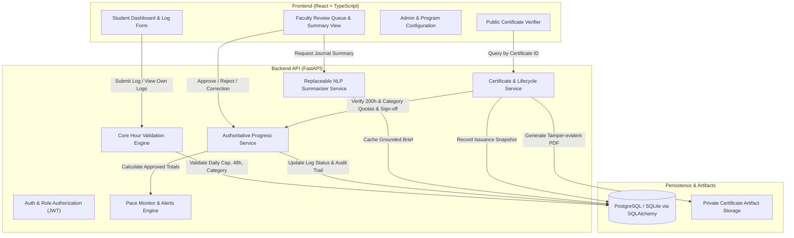

# Architecture & System Design: Shailja Yoga Certification Platform

## 1. System Overview

The Shailja Yoga platform is organized into a clean decoupled architecture composed of:
1. **Frontend:** React with TypeScript, Vite, Tailwind CSS / modern component styling, React Router.
2. **Backend API:** FastAPI (Python 3.12+ / 3.14 compatible), Pydantic v2 schemas, SQLAlchemy 2.0 ORM.
3. **Database & Migrations:** PostgreSQL (production) with SQLite fallback (local offline hackathon development), managed with Alembic.
4. **Asynchronous / Background Jobs:** Background worker for pace checks and notification delivery.
5. **NLP Module:** Replaceable summarization interface (`MockSummarizer`, `GeminiSummarizer`, `OpenAISummarizer`).
6. **Certificate Engine:** ReportLab-based dynamic PDF generator with cryptographic checksums, issuance snapshotting, and QR codes.

---

## 2. Component Boundaries & Responsibilities

### 2.1 Backend Core Services
- **`app.core.security`**: Token issuance, password hashing (bcrypt), role authorization dependencies (`require_roles([Role.FACULTY, Role.ADMIN])`).
- **`app.services.validation_service`**: Enforces non-negotiable business rules:
  - 8-hour daily cap across all categories combined for a single student on a program-local calendar day.
  - 48-hour submission window from practice date.
  - Non-positive duration rejection.
  - Future date rejection.
  - Concurrency safety with database row/table locks or atomic transactions.
- **`app.services.progress_service`**: Authoritative calculation of approved hours, category distribution, pending hours, and remaining hours. Used consistently across dashboards, pace checks, and certification.
- **`app.services.pace_service`**: Calculates linear expected progress, remaining days, required weekly pace, shortfall, and safe catch-up pace (respecting the 8-hour/day cap).
- **`app.services.summary_service`**: Generates grounded bulleted summaries (`Key Learning`, `Practice Reflection`, `Topics for Review`) from journals without affecting review status or verified hours.
- **`app.services.certificate_service`**: Evaluates eligibility (200 approved hours, category quotas satisfied or confirmed, faculty sign-off complete, no active certificate). Issues signed PDF and immutable snapshot. Handles revocation and superseding certificates.
- **`app.services.audit_service`**: Implements append-only audit event logging for all state transitions (log creation, review decisions, corrections, certificate issuance, certificate revocation).

### 2.2 Storage Architecture
- **Database (PostgreSQL / SQLite):** Normalized relational tables with foreign keys and unique constraints.
- **Certificate Storage:** Private filesystem directory (`backend/storage/certificates/`). PDF files are served only through authorized endpoints; direct filesystem paths are never leaked to clients.

---

## 3. Concurrency & Race Condition Mitigation
To prevent race conditions where a student makes simultaneous submissions that together exceed 8 hours on a single day:
- Submissions for the same student and practice date execute within a database transaction with serializable isolation or an explicit row-level / advisory lock on the student's enrollment record.
- The existing sum of hours for that day is calculated inside the locked transaction before inserting the new log.

---

## 4. Authoritative Timezone Handling
- Practice date is captured as a local calendar date (`YYYY-MM-DD`).
- The program's timezone (e.g. `Asia/Kolkata`) defines the calendar day boundary (00:00:00 to 23:59:59).
- Submissions record `submitted_at` in authoritative UTC on the server.
- The 48-hour backdating rule is evaluated by comparing the server's UTC time with the practice date converted to the program's timezone.
